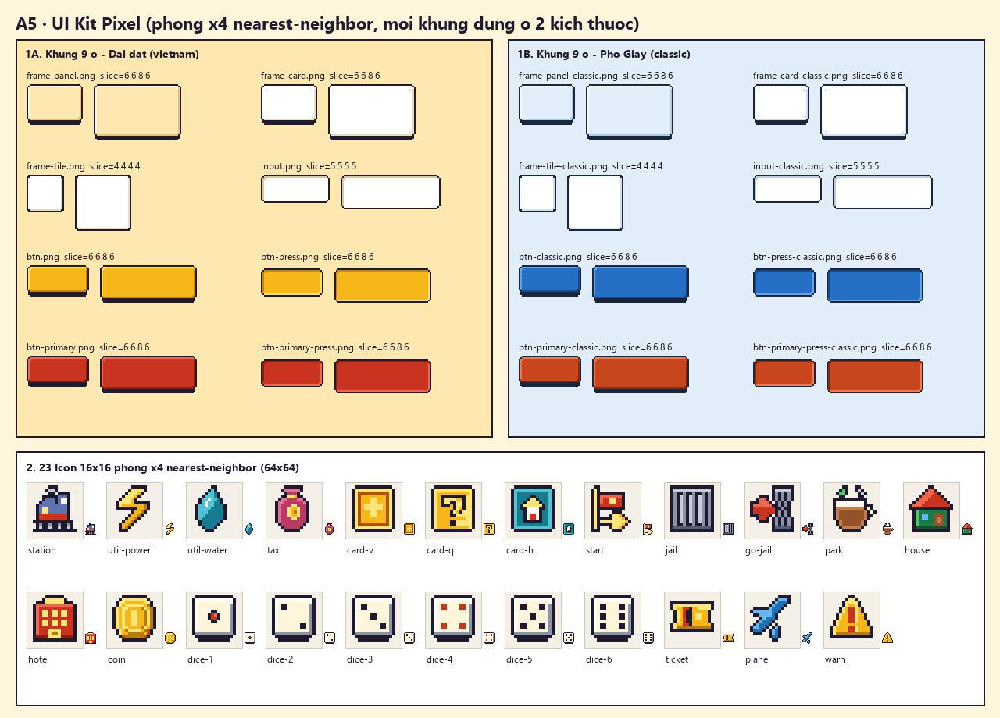
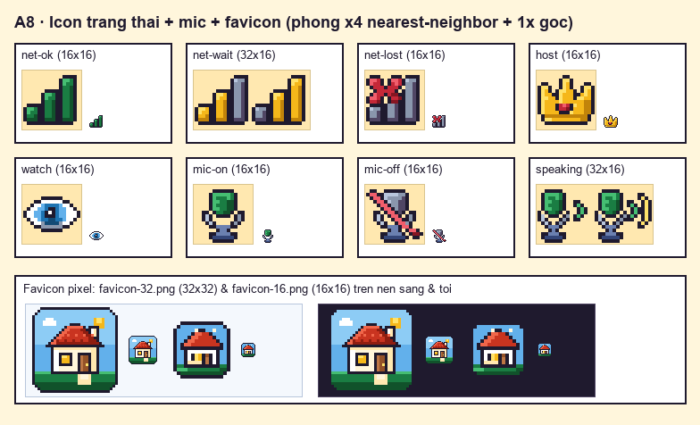

# UI kit pixel (`assets/ui/`) — A5

Bộ khung 9 ô (`border-image`) và 23 icon 16×16 pixel art vẽ ở độ phân giải gốc (không khử răng cưa, nền trong suốt, mọi PNG < 1 KB). Màu lấy trực tiếp từ `design/themes/palettes.md`.

## 1. Khung 9 ô (`border-image`)

Mọi ảnh dùng `image-rendering: pixelated; border-image-repeat: stretch;`.
Mặc định (không hậu tố) dùng bảng màu **Dải đất (`vietnam`)**; các file có hậu tố `-classic.png` dùng bảng màu **Phố Giấy (`classic`)**.

| File (Dải đất / Phố Giấy) | Kích thước gốc | `border-image-slice` | `border-image-width` gợi ý (`--px`) | Công dụng |
|---|---|---|---|---|
| `frame-panel.png` / `frame-panel-classic.png` | 24×24 | `6 6 8 6 fill` | `calc(6*var(--px)) calc(6*var(--px)) calc(8*var(--px)) calc(6*var(--px))` | Bảng, cột bên, khu trung tâm (`--surface-2`) |
| `frame-card.png` / `frame-card-classic.png` | 24×24 | `6 6 8 6 fill` | `calc(6*var(--px)) calc(6*var(--px)) calc(8*var(--px)) calc(6*var(--px))` | Thẻ đất, thẻ Vận mệnh, hộp thoại (`--surface`) |
| `frame-tile.png` / `frame-tile-classic.png` | 16×16 | `4 fill` | `calc(4 * var(--px))` | Ô bàn cờ gọn sắc nét (`--surface`) |
| `btn.png` / `btn-classic.png` | 24×24 | `6 6 8 6 fill` | `calc(6*var(--px)) calc(6*var(--px)) calc(8*var(--px)) calc(6*var(--px))` | Nút phụ (`--accent-2`), bóng cứng đáy 2px |
| `btn-press.png` / `btn-press-classic.png` | 24×24 | `6 6 8 6 fill` | `calc(6*var(--px)) calc(6*var(--px)) calc(8*var(--px)) calc(6*var(--px))` | Trạng thái nhấn của `btn` (lún xuống 2px gốc) |
| `btn-primary.png` / `btn-primary-classic.png` | 24×24 | `6 6 8 6 fill` | `calc(6*var(--px)) calc(6*var(--px)) calc(8*var(--px)) calc(6*var(--px))` | Nút chính CTA (`--accent`), chữ `#FFFFFF` |
| `btn-primary-press.png` / `btn-primary-press-classic.png` | 24×24 | `6 6 8 6 fill` | `calc(6*var(--px)) calc(6*var(--px)) calc(8*var(--px)) calc(6*var(--px))` | Trạng thái nhấn của `btn-primary` (lún xuống 2px gốc) |
| `input.png` / `input-classic.png` | 24×24 | `5 fill` | `calc(5 * var(--px))` | Ô nhập chữ chìm nhẹ, ruột `#FFFFFF` |

### Mẫu CSS dùng nhanh trong `components.css` (U3p)

```css
.px-btn-primary {
  border-style: solid;
  border-color: transparent;
  border-width: calc(6 * var(--px)) calc(6 * var(--px)) calc(8 * var(--px)) calc(6 * var(--px));
  border-image: url("../../assets/ui/btn-primary.png") 6 6 8 6 fill / 1 / 0 stretch;
  image-rendering: pixelated;
  color: #FFFFFF;
}
.px-btn-primary:active {
  border-image-source: url("../../assets/ui/btn-primary-press.png");
  /* chữ bên trong dịch xuống calc(2 * var(--px)) để khớp mặt nút lún */
}
```

## 2. Icon 16×16 (`assets/ui/icons/`)

Phóng nguyên bội `calc(16 * var(--px))` hoặc `16px` / `32px` / `48px` kèm `image-rendering: pixelated`.
Các icon hoạt ảnh 2 khung (`net-wait.png`, `speaking.png`) có kích thước `32×16` (2 khung `16×16` xếp ngang, dùng `background-size: 200% 100%` + `steps(2)`).

| Nhóm | File |
|---|---|
| Ô đặc biệt & bộ thẻ | `station.png`, `util-power.png`, `util-water.png`, `tax.png`, `card-v.png`, `card-q.png`, `card-h.png` |
| 4 ô góc | `start.png`, `jail.png`, `go-jail.png`, `park.png` |
| Công trình & tiền | `house.png`, `hotel.png`, `coin.png` |
| Xúc xắc 1–6 | `dice-1.png`, `dice-2.png`, `dice-3.png`, `dice-4.png`, `dice-5.png`, `dice-6.png` |
| Vé, hành động, cảnh báo | `ticket.png`, `plane.png`, `warn.png` |
| Trạng thái, vai trò & mic (A8) | `net-ok.png`, `net-wait.png` (32×16, 2 khung), `net-lost.png`, `host.png`, `watch.png`, `mic-on.png`, `mic-off.png`, `speaking.png` (32×16, 2 khung) |

## 2b. Favicon pixel (A8)

- `assets/ui/favicon-32.png` (32×32) và `assets/ui/favicon-16.png` (16×16, vẽ tay riêng từng pixel, không thu nhỏ từ 32×32): huy hiệu ngôi nhà Phố Giấy mái đỏ son `--accent`, cửa sổ vàng `--accent-2`, viền mực `--ink`, đọc rõ cả nền tab sáng lẫn tối.

## 3. Bảng màu sử dụng (trích `design/themes/palettes.md`)

- **Dải đất (`vietnam`, mặc định):** mực `#1F1A2E`, nền thẻ `#FFFFFF`, nền bảng `#FFE8B0` (sáng `#FFF6DC`, bóng `#E5C272`), nút chính `#C93420` (sáng `#F0664A`, bóng `#8F1D10`), nút phụ `#F5B71A` (sáng `#FFE066`, bóng `#C48708`).
- **Phố Giấy (`-classic`):** mực `#1B263B`, nền thẻ `#FFFFFF`, nền bảng `#E1EDF9` (sáng `#F4F8FD`, bóng `#AFC9E6`), nút chính `#C7461E` (sáng `#F0784C`, bóng `#8A2A0E`), nút phụ `#2570C4` (sáng `#5FA3F0`, bóng `#174C8C`).
- **Icon:** mực `#1F1A2E`, kết hợp màu ô đặc biệt trong `palettes.md` (`--station` `#344678`, `--util` `#177D8C`, `--tax` `#B83B64`, `--card` `#B05206`, `--good` `#1A7D43`, `--accent` `#C93420`, `--accent-2` `#F5B71A`, `--d2` `#1D73B2`).

## 4. Ảnh kiểm tra




