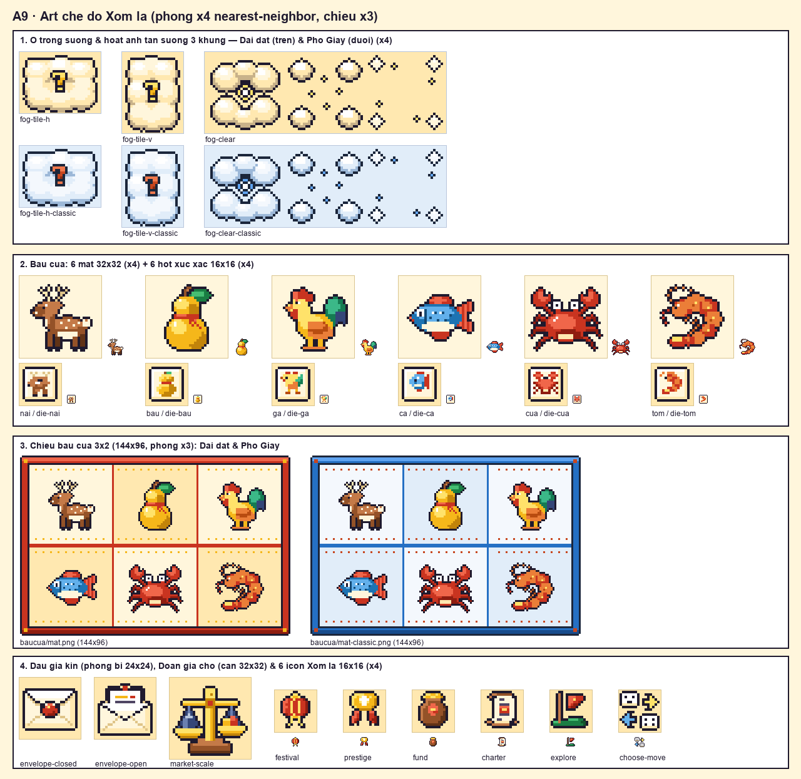

# Art pixel chế độ "Xóm lạ" (`assets/xomla/`) — A9

Toàn bộ ảnh vẽ ở kích thước gốc, không khử răng cưa, nền trong suốt, dùng bảng màu `design/themes/palettes.md` (A1) và viền ngoài 1px màu `--ink` (`#1F1A2E` cho Dải đất, `#1B263B` cho Phố Giấy). Khi hiển thị dùng `image-rendering: pixelated` và phóng nguyên bội.

## 1. Ô trong sương (`assets/xomla/fog/`)

| File (Dải đất / Phố Giấy) | Kích thước | Ghi chú dùng trong UI (U9) |
|---|---|---|
| `fog-tile-h.png` / `fog-tile-h-classic.png` | 32×24 | Che ô nằm ngang (cạnh trên/dưới), đám mây pixel có dấu "?" |
| `fog-tile-v.png` / `fog-tile-v-classic.png` | 24×32 | Che ô nằm dọc (cạnh trái/phải), đám mây pixel có dấu "?" |
| `fog-clear.png` / `fog-clear-classic.png` | 96×32 | **3 khung 32×32 xếp ngang** (`steps(3)`), dùng khi mở ô tan sương |

## 2. Bầu cua (`assets/xomla/baucua/`)

| Nhóm | File | Kích thước |
|---|---|---|
| 6 mặt linh vật | `nai.png`, `bau.png`, `ga.png`, `ca.png`, `cua.png`, `tom.png` | 32×32 |
| 6 mặt hột xúc xắc | `die-nai.png`, `die-bau.png`, `die-ga.png`, `die-ca.png`, `die-cua.png`, `die-tom.png` | 16×16 |
| Chiếu bầu cua 3×2 (có in sẵn linh vật) | `mat.png` (Dải đất), `mat-classic.png` (Phố Giấy) | 144×96 |
| Chiếu bầu cua 3×2 (khung trống để đặt ô bấm riêng) | `mat-empty.png` (Dải đất), `mat-empty-classic.png` (Phố Giấy) | 144×96 |

Thứ tự 6 ô trên chiếu (trái → phải, trên → dưới): `nai`, `bau`, `ga` (hàng 1); `ca`, `cua`, `tom` (hàng 2). Tọa độ lõi từng ô trên chiếu `144×96`: rộng `44px` × cao `42px`, bắt đầu tại `x = 5 + col * 45`, `y = 5 + row * 44`.

## 3. Đấu giá kín & Đoán giá chợ (`assets/xomla/`)

| File | Kích thước | Công dụng |
|---|---|---|
| `envelope-closed.png` | 24×24 | Phong bì giá đóng kín có dấu sáp đỏ (đấu giá kín — chờ mở) |
| `envelope-open.png` | 24×24 | Phong bì đã mở nắp lộ tờ giấy ghi giá |
| `market-scale.png` | 32×32 | Cái cân đĩa chợ (trò Đoán giá chợ) |

## 4. 6 Icon Xóm lạ 16×16 (`assets/xomla/icons/`)

| File | Ý nghĩa |
|---|---|
| `festival.png` | Ô hội làng (đèn lồng đỏ son tua vàng) |
| `prestige.png` | Uy tín (huy chương vàng mai ruy-băng đỏ) |
| `fund.png` | Quỹ đình (hũ tiền đất nung đầy xu vàng) |
| `charter.png` | Hương ước (cuộn giấy cổ buộc dây đỏ) |
| `explore.png` | Khai hoang (cờ cắm trên mô đất xanh) |
| `choose-move.png` | Chọn cách đi (2 hột xúc xắc + mũi tên rẽ hướng) |

## 5. Ảnh kiểm tra

