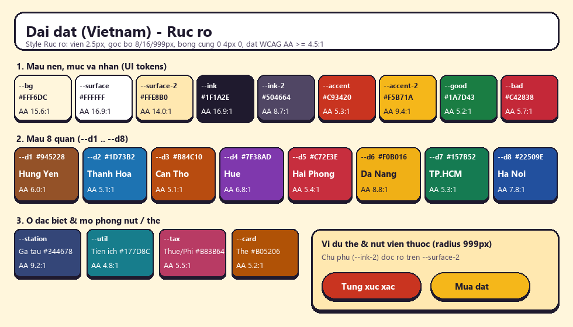
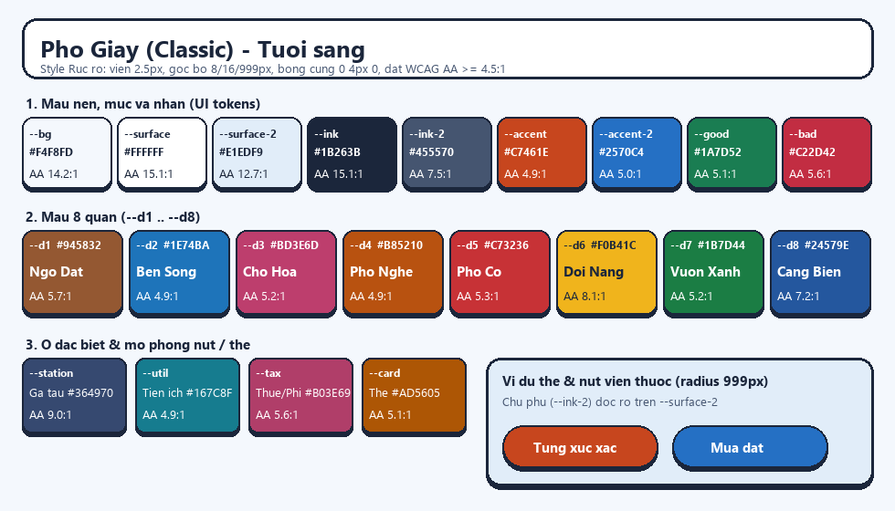

# Bảng màu & hoa văn theo vùng đất — Style "Rực rỡ" (A1)

Tài liệu nguồn cho Codex triển khai `design/themes/vietnam.css` và `design/themes/classic.css` (việc U1 trong `docs/UI_REFRESH.md`).
Mọi cặp chữ/nền đã kiểm chứng tự động đạt **WCAG 2.1 AA ≥ 4,5:1** (thấp nhất hiện tại là `4,83:1`).

---

## 1. Biến hình khối & chữ dùng chung (2 vùng đất)

| Biến | Giá trị | Ghi chú |
|---|---|---|
| `--radius-sm` | `8px` | Ô bàn cờ, huy hiệu nhỏ |
| `--radius-md` | `16px` | Thẻ đất, thẻ Vận mệnh, hộp bảng |
| `--radius-lg` | `999px` | Nút bấm dạng viên thuốc |
| `--border` | `2.5px solid var(--ink)` | Viền đậm kiểu sticker, ăn khớp sprite kiểu A · Pixel |
| `--shadow` | `0 4px 0 var(--ink)` | Bóng cứng nổi 3D tạo cảm giác bấm được |
| `--shadow-press` | `0 1px 0 var(--ink)` | Bóng thu lại khi nhấn nút (`translateY(3px)`) |
| `--font-display` | `"Baloo 2", "Inter", sans-serif` | Tiêu đề tròn vui, đủ dấu tiếng Việt |

---

## 2. Vùng đất `vietnam` — Dải đất (Việt Nam)

**Cảm hứng:** Vàng kem nắng phương Nam (`#FFF6DC`), đỏ son sơn mài (`#C93420`), vàng hoa mai (`#F5B71A`), xanh ngọc biển và 8 sắc tỉnh thành bão hòa rõ rệt để liếc nhanh là phân biệt ngay.
**Hoa văn nền:** `../../assets/themes/vietnam-pattern.svg` (sóng nước & mây cách điệu nhẹ màu vàng đất độ mờ thấp, không át chữ).
**Swatch:** 

```css
[data-map="vietnam"] {
  --bg: #FFF6DC;
  --bg-pattern: url("../../assets/themes/vietnam-pattern.svg");
  --surface: #FFFFFF;
  --surface-2: #FFE8B0;

  --ink: #1F1A2E;
  --ink-2: #504664;
  --accent: #C93420;      /* chữ #FFFFFF · AA 5.26:1 */
  --accent-2: #F5B71A;    /* chữ var(--ink) · AA 9.37:1 */
  --good: #1A7D43;        /* chữ #FFFFFF · AA 5.17:1 */
  --bad: #C42838;         /* chữ #FFFFFF · AA 5.66:1 */

  /* 8 quận (đi kèm hoa văn cũ cho người mù màu) */
  --d1: #945228;          /* Hưng Yên — nâu đất nung · #FFF 6.01:1 */
  --d2: #1D73B2;          /* Thanh Hóa ★ — đá xanh lam · #FFF 5.06:1 */
  --d3: #B84C10;          /* Cần Thơ — cam trái cây · #FFF 5.15:1 */
  --d4: #7F38AD;          /* Huế — tím cố đô · #FFF 6.84:1 */
  --d5: #C72E3E;          /* Hải Phòng — đỏ hoa phượng · #FFF 5.40:1 */
  --d6: #F0B016;          /* Đà Nẵng — vàng rồng · var(--ink) 8.77:1 */
  --d7: #157B52;          /* TP.HCM — xanh ngọc năng động · #FFF 5.27:1 */
  --d8: #22509E;          /* Hà Nội — xanh hồ sâu · #FFF 7.75:1 */

  --station: #344678;     /* Ga tàu · #FFF 9.16:1 */
  --util: #177D8C;        /* Điện lực / Nước sạch · #FFF 4.83:1 */
  --tax: #B83B64;         /* Trạm thu phí / Phí đỗ xe · #FFF 5.46:1 */
  --card: #B05206;        /* Vận mệnh · #FFF 5.18:1 */

  --radius-sm: 8px;
  --radius-md: 16px;
  --radius-lg: 999px;
  --border: 2.5px solid var(--ink);
  --shadow: 0 4px 0 var(--ink);
  --shadow-press: 0 1px 0 var(--ink);
  --font-display: "Baloo 2", "Inter", sans-serif;
  --board-art: none;      /* cập nhật khi có A4: assets/themes/vietnam-board.svg */
}
```

### Kiểm chứng tương phản WCAG AA (`vietnam`)

| Cặp màu | Chữ | Nền | Tỉ lệ | Đạt AA |
|---|---|---|---|---|
| Chữ chính / nền chính | `#1F1A2E` | `#FFF6DC` | `15.63:1` | ✅ AAA |
| Chữ chính / thẻ | `#1F1A2E` | `#FFFFFF` | `16.86:1` | ✅ AAA |
| Chữ chính / nền phụ | `#1F1A2E` | `#FFE8B0` | `13.99:1` | ✅ AAA |
| Chữ phụ / nền chính | `#504664` | `#FFF6DC` | `8.11:1` | ✅ AAA |
| Chữ phụ / nền phụ | `#504664` | `#FFE8B0` | `7.26:1` | ✅ AAA |
| Nút chính (`--accent`) | `#FFFFFF` | `#C93420` | `5.26:1` | ✅ AA |
| Nút phụ (`--accent-2`) | `#1F1A2E` | `#F5B71A` | `9.37:1` | ✅ AAA |
| Trạng thái tốt / xấu | `#FFFFFF` | `#1A7D43` / `#C42838` | `5.17:1` / `5.66:1` | ✅ AA |
| 8 quận (`--d1`…`--d8`) | `#FFFFFF` (riêng `--d6`: `#1F1A2E`) | từng màu quận | `5.06:1` – `8.77:1` | ✅ AA |
| Ô đặc biệt (`station`, `util`, `tax`, `card`) | `#FFFFFF` | từng màu ô | `4.83:1` – `9.16:1` | ✅ AA |

---

## 3. Vùng đất `classic` — Phố Giấy (bàn gốc, tươi sáng)

**Cảm hứng:** Giữ chất giấy thủ công sạch sẽ của Phố Giấy nhưng chuyển từ kem trầm sang giấy xanh trời sáng (`#F4F8FD`), cam đất nung rực (`#C7461E`), xanh trời (`#2570C4`) và hồng phấn Chợ Hoa (`#BD3E6D`).
**Hoa văn nền:** `../../assets/themes/classic-pattern.svg` (lưới đứt giấy cắt dán, nếp gấp tam giác và chấm màu nhẹ).
**Swatch:** 

```css
[data-map="classic"] {
  --bg: #F4F8FD;
  --bg-pattern: url("../../assets/themes/classic-pattern.svg");
  --surface: #FFFFFF;
  --surface-2: #E1EDF9;

  --ink: #1B263B;
  --ink-2: #455570;
  --accent: #C7461E;      /* chữ #FFFFFF · AA 4.86:1 */
  --accent-2: #2570C4;    /* chữ #FFFFFF · AA 5.01:1 */
  --good: #1A7D52;        /* chữ #FFFFFF · AA 5.12:1 */
  --bad: #C22D42;         /* chữ #FFFFFF · AA 5.60:1 */

  /* 8 quận Phố Giấy tươi hơn */
  --d1: #945832;          /* Ngõ Đất · #FFF 5.67:1 */
  --d2: #1E74BA;          /* Bến Sông · #FFF 4.93:1 */
  --d3: #BD3E6D;          /* Chợ Hoa — hồng phấn rực · #FFF 5.16:1 */
  --d4: #B85210;          /* Phố Nghề — cam đất nung · #FFF 4.94:1 */
  --d5: #C73236;          /* Phố Cổ — đỏ son · #FFF 5.33:1 */
  --d6: #F0B41C;          /* Đồi Nắng — vàng nắng · var(--ink) 8.11:1 */
  --d7: #1B7D44;          /* Vườn Xanh · #FFF 5.17:1 */
  --d8: #24579E;          /* Cảng Biển · #FFF 7.16:1 */

  --station: #364970;     /* 4 Ga · #FFF 8.96:1 */
  --util: #167C8F;        /* Trạm Điện / Giếng Nước · #FFF 4.87:1 */
  --tax: #B03E69;         /* Phí Chợ / Phí Cảng · #FFF 5.62:1 */
  --card: #AD5605;        /* Câu hỏi / Hàng xóm · #FFF 5.11:1 */

  --radius-sm: 8px;
  --radius-md: 16px;
  --radius-lg: 999px;
  --border: 2.5px solid var(--ink);
  --shadow: 0 4px 0 var(--ink);
  --shadow-press: 0 1px 0 var(--ink);
  --font-display: "Baloo 2", "Inter", sans-serif;
  --board-art: none;      /* cập nhật khi có A4: assets/themes/classic-board.svg */
}
```

### Kiểm chứng tương phản WCAG AA (`classic`)

| Cặp màu | Chữ | Nền | Tỉ lệ | Đạt AA |
|---|---|---|---|---|
| Chữ chính / nền chính | `#1B263B` | `#F4F8FD` | `14.20:1` | ✅ AAA |
| Chữ chính / thẻ | `#1B263B` | `#FFFFFF` | `15.14:1` | ✅ AAA |
| Chữ chính / nền phụ | `#1B263B` | `#E1EDF9` | `12.75:1` | ✅ AAA |
| Chữ phụ / nền chính | `#455570` | `#F4F8FD` | `7.07:1` | ✅ AAA |
| Chữ phụ / nền phụ | `#455570` | `#E1EDF9` | `6.35:1` | ✅ AA+ |
| Nút chính / nút phụ | `#FFFFFF` | `#C7461E` / `#2570C4` | `4.86:1` / `5.01:1` | ✅ AA |
| Trạng thái tốt / xấu | `#FFFFFF` | `#1A7D52` / `#C22D42` | `5.12:1` / `5.60:1` | ✅ AA |
| 8 quận (`--d1`…`--d8`) | `#FFFFFF` (riêng `--d6`: `#1B263B`) | từng màu quận | `4.93:1` – `8.11:1` | ✅ AA |
| Ô đặc biệt (`station`, `util`, `tax`, `card`) | `#FFFFFF` | từng màu ô | `4.87:1` – `8.96:1` | ✅ AA |

---

## 4. Lưu ý nhanh cho Codex khi viết CSS (U1 / U3)
- Trên nền vàng sáng (`vietnam`: `--accent-2`, `--d6`; `classic`: `--d6`), đặt màu chữ là `var(--ink)` thay vì `#FFFFFF` để giữ tương phản > 8:1. Mọi màu quận và nút nhấn còn lại đều đạt ≥ 4,8:1 với chữ `#FFFFFF`.
- Hoa văn `--bg-pattern` dùng nền trong suốt nên đặt `background-color: var(--bg); background-image: var(--bg-pattern); background-repeat: repeat;`.
