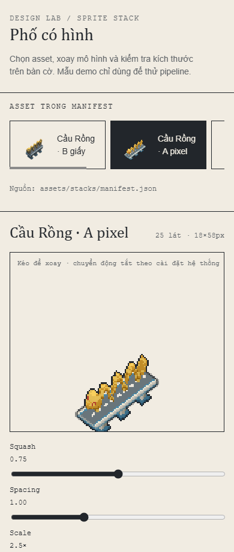
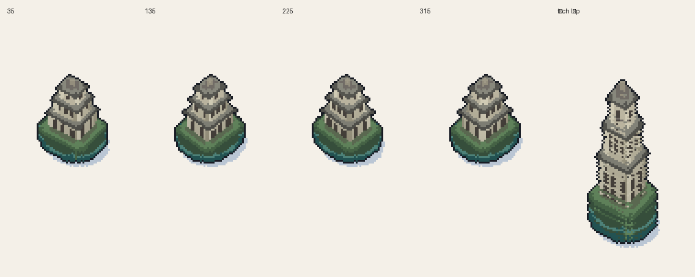

# Nhật ký agent Agy

## 2026-11-27 · G6
- Đã tạo nội dung chữ cho map Việt Nam (40 ô, 13 loại thẻ Vận mệnh, gợi ý Thanh Hóa) và chạy `node --test tests/*.test.mjs` (17/17 xanh).
- File: `content/vietnam.json`.

## 2026-11-27 · G1 (Cổng duyệt 1 → chốt kiểu A · Pixel, sửa mái Tháp Rùa)
- Đã tạo đủ 3 địa danh thử × 2 kiểu (**A · Pixel** và **B · Giấy xếp lớp** = 6 asset), chạy `../Monopoly-codex/tools/art/build_stacks.py --bake16` ra dải lát cắt, sheet 16 góc, 6 check sheet và `manifest.json`; mọi ảnh gốc dưới 5 KB, mọi dải lát cắt dưới 7 KB (dưới ngưỡng 60 KB / 400 KB).
- Theo phản hồi của người dùng ở Cổng duyệt 1 (**chọn kiểu A · Pixel** và góp ý mái Tháp Rùa không phải màu đỏ): đã sửa mái Tháp Rùa sang màu đá xám rêu phong cổ (`#7A776C`/`#5F5D54`, chóp đá `#9E9887`) khớp kiến trúc thật, cắt lớp lại và chụp mới `g1-lab-compare.png`.
- File: `assets/stacks/src/*`, `assets/stacks/out/*`, `assets/stacks/check/*`, `assets/stacks/manifest.json`, `assets/stacks/SOURCES.md`, `design/lab/g1-compare.html`.
- Việc tiếp theo: chờ người dùng xác nhận bản Tháp Rùa đã sửa màu mái rồi bắt đầu **G2 (`assets/stacks/STYLE.md`)** và **G3 đợt 1** (6 địa danh Hưng Yên, Thanh Hóa) theo **kiểu A · Pixel**.
- Đề xuất gửi Codex (không tự sửa vùng của Codex):
  1. Trong `src/render/stack.js:186` (`mountTurntable`), dòng `(canvas.clientHeight + size.height * scale) / 2 - 4` đang đặt `baseY` xuống sát đáy canvas nên khi `scale >= 3.5` đáy mô hình bị cắt ở mép dưới (thấy rõ ở ảnh `g1-lab-mobile.png` và `deedCanvas` trong `stack.html:95`). Đề xuất đổi thành `(canvas.clientHeight - size.height * scale) / 2 + size.baseY * scale` để căn đúng giữa khung.
  2. Trong `tools/art/build_stacks.py:84`, font mặc định của Pillow không hỗ trợ dấu tiếng Việt nên nhãn `"tách lớp"` trên check sheet hiện `t□ch l□p`; có thể dùng `"tach lop"` hoặc nạp font TTF hệ thống.

### Cổng duyệt 1 · Bảng so sánh A (Pixel) vs B (Giấy xếp lớp) trên `src/render/stack.js`

### Ảnh chụp trang lab của Codex (`design/lab/stack.html`) với manifest G1 thật

| Desktop (1280px, Tháp Rùa · B giấy + Xem trên bàn) | Mobile (390px, Cầu Rồng · A pixel) |
|---|---|
|  |  |

### 6 Check sheet (4 góc 35°/135°/225°/315° + tách lớp)

| Địa danh | A · Pixel | B · Giấy xếp lớp |
|---|---|---|
| **Hồ Hoàn Kiếm – Tháp Rùa** |  |  |
| **Cầu Rồng (`parts`)** |  |  |
| **Chợ Bến Thành (`parts`)** |  |  |
