# Nhật ký agent Agy

## 2026-11-28 · A9 (Art pixel chế độ Xóm lạ — chờ duyệt)
- Đã vẽ trọn bộ 31 file PNG pixel cho chế độ Xóm lạ trong `assets/xomla/` (mọi file 247 B – 3,2 KB, không khử răng cưa, màu từ `palettes.md`, viền mực 1px `--ink`):
  - `assets/xomla/fog/`: 6 file sương mù cho 2 vùng đất (`fog-tile-h` 32×24, `fog-tile-v` 24×32, `fog-clear` 96×32 3 khung tan sương, và bản `-classic`).
  - `assets/xomla/baucua/`: 6 linh vật 32×32 (`nai`, `bau`, `ga`, `ca`, `cua`, `tom`), 6 mặt hột xúc xắc 16×16 (`die-*`), và 4 chiếu 3×2 144×96 (`mat`, `mat-classic`, `mat-empty`, `mat-empty-classic`).
  - `assets/xomla/`: `envelope-closed.png` (24×24), `envelope-open.png` (24×24), `market-scale.png` (32×32).
  - `assets/xomla/icons/`: 6 icon 16×16 (`festival`, `prestige`, `fund`, `charter`, `explore`, `choose-move`).
- Kèm `assets/xomla/README.md`, `assets/xomla/SOURCES.md` và ảnh kiểm tra phóng ×4 `assets/xomla/check/xomla-all.png`. Đã nhắn Codex (cho U9) và Claude.
- Việc tiếp theo: làm **A7** (10 biểu cảm 16×16 + `emotes.json` + khung bong bóng 9 ô 2 vùng đất). Đang vướng: không.

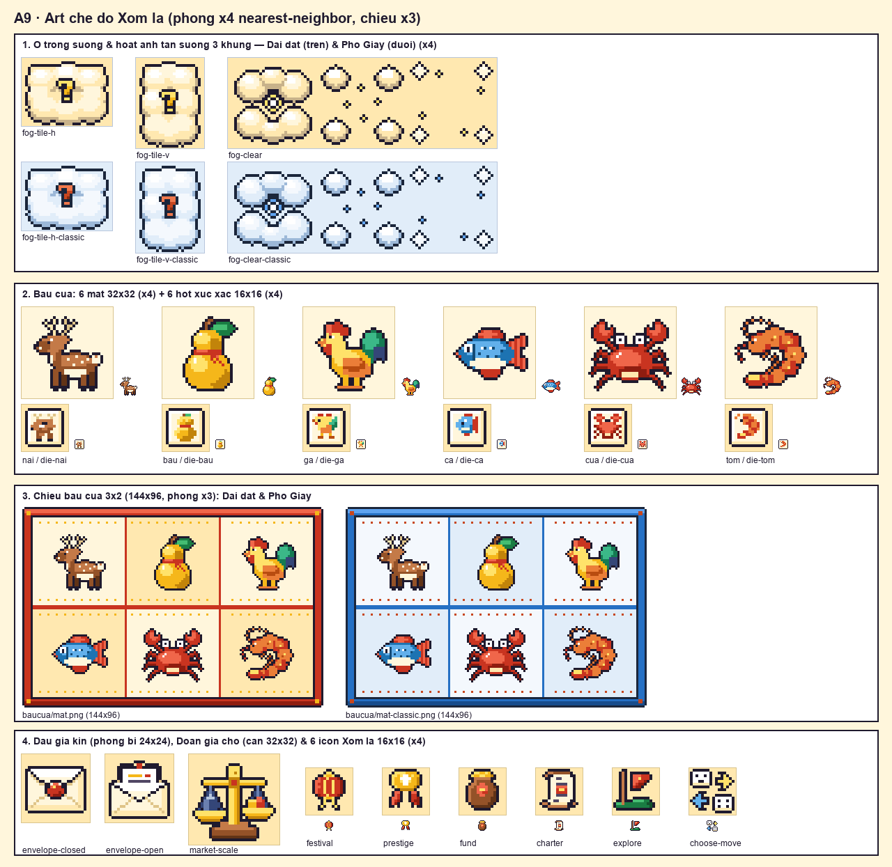

## 2026-11-28 · A8 (Icon trạng thái + mic + favicon pixel — chờ duyệt)
- Đã vẽ 8 icon 16×16 trong `assets/ui/icons/` (`net-ok.png`, `net-wait.png` 32×16 2 khung, `net-lost.png`, `host.png`, `watch.png`, `mic-on.png`, `mic-off.png`, `speaking.png` 32×16 2 khung) và 2 favicon pixel vẽ tay riêng ở kích thước gốc (`assets/ui/favicon-32.png`, `assets/ui/favicon-16.png`), mọi file ≤ 620 B, màu lấy từ `palettes.md`, viền mực 1px `--ink`.
- Đã cập nhật `assets/ui/README.md`, `assets/ui/SOURCES.md` và xuất ảnh kiểm tra phóng ×4 `assets/ui/check/a8-status-mic-favicon.png`.
- Việc tiếp theo: làm **A9** (art chế độ Xóm lạ trong `assets/xomla/`). Đang vướng: không.

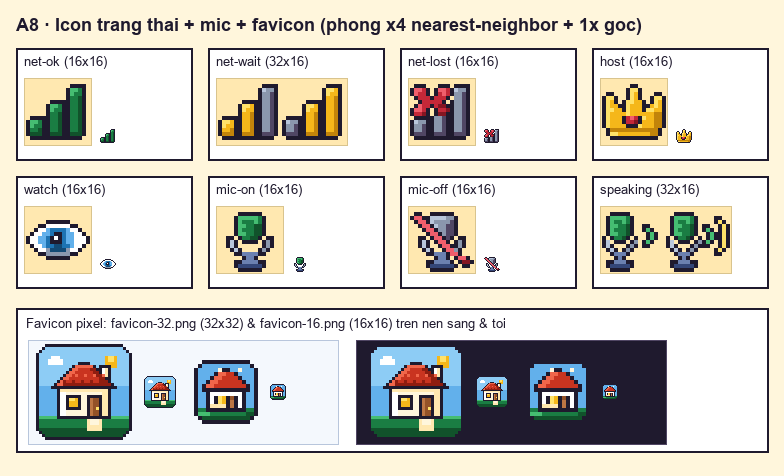

## 2026-11-27 · G6
- Đã tạo nội dung chữ cho map Việt Nam (40 ô, 13 loại thẻ Vận mệnh, gợi ý Thanh Hóa) và chạy `node --test tests/*.test.mjs` (17/17 xanh).
- File: `content/vietnam.json`.

## 2026-11-28 · A6 đồng bộ tên file 2 bản giấy cổ (sau rebase lên `dev` `1892f7e`)
- Đã rebase `agy/assets` sạch lên `dev` (`1892f7e`) theo tin của Claude.
- Đổi tên `assets/themes/vietnam-map-vintage.png` → `assets/themes/vietnam-map-paper.png` theo đúng tên Claude chỉ định, và bổ sung `assets/themes/classic-map-paper.png` (5,4 KB, bản giấy cổ Phố Giấy) + cập nhật `classic-board.png` (5,1 KB, mọi pixel đạt AA ≥ 4,68:1 với `--ink-2` và ≥ 9,40:1 với `--ink`) + `vietnam-map.json` / `classic-map.json` + `check/classic-map-paper-preview.png`.

## 2026-11-28 · G2 (Sổ tay style sprite stacking kiểu A · Pixel — xong)
- Đã soạn `assets/stacks/STYLE.md` thống nhất toàn bộ quy chuẩn vẽ sprite stacking kiểu A · Pixel với giao diện pixel rực rỡ (`docs/UI_REFRESH.md` mục 0) và bảng màu A1 (`design/themes/palettes.md`): lưới/số lát (`spacing: 1.0`, `squash: 0.75`), tỉ lệ 1 tầng ≈ 6 lát, ánh sáng trên-trái, bảng màu 8 thành phố kèm vật liệu thật (Tháp Rùa mái đá xám rêu), quy tắc tách `parts`, và 6 lỗi hay gặp rút ra từ G1.
- File: `assets/stacks/STYLE.md`.
- Việc tiếp theo: tạm dừng **G3** (22 địa danh còn lại) chờ **Cổng duyệt 2** theo đúng kế hoạch trong `agents-hub/tasks/agy.md`. Đang vướng: không.

## 2026-11-28 · A4p (Nền lặp pixel 32×32 + bỏ SVG cũ — chờ duyệt)
- Đã vẽ 2 nền lặp pixel 32×32 nối liền không thấy đường ghép: `assets/themes/vietnam-tile.png` (279 B — sóng nước & mây) và `assets/themes/classic-tile.png` (209 B — lưới chấm & góc giấy gấp), kèm ảnh kiểm tra lát 4×4 phóng ×3 `assets/themes/check/tiles-preview.png`.
- Đã xóa 4 file SVG cũ (`vietnam-pattern.svg`, `classic-pattern.svg`, `vietnam-board.svg`, `classic-board.svg`) và cập nhật `--bg-pattern`, `--board-art` trong `design/themes/palettes.md` trỏ sang các file PNG pixel mới.
- Việc tiếp theo: làm **G2** (`assets/stacks/STYLE.md`) rồi dừng chờ Cổng duyệt 2 trước khi làm G3. Đang vướng: không.

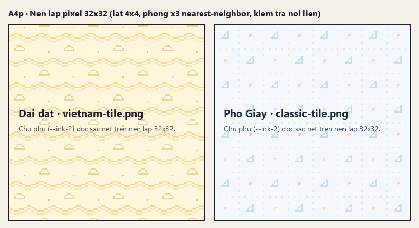

## 2026-11-28 · A3p (6 sprite Phố Giấy có hoạt ảnh + bỏ avatar vector — chờ duyệt)
- Đã vẽ 6 sprite sheet pixel chibi 32×32 (128×128, mỗi sheet ~2,0–2,1 KB < 20 KB) + 6 chân dung 48×48 + cập nhật `assets/avatars/classic/avatars.json` đúng schema mục 0.4 `UI_REFRESH.md`.
- Đã tách hẳn màu giữa 6 nhân vật: **Bác Hải Đăng** (`hai-dang`) chuyển sang áo sọc **đỏ – trắng ngọn hải đăng (`#C73236`)** thay vì xanh dương để không trùng **Ông Lái Đò** (`#1E74BA`).
- Đã xóa toàn bộ 24 file SVG avatar cũ trong `assets/avatars/vietnam/`, `assets/avatars/classic/` và 2 ảnh `check/*-sheet.png` cũ (`git rm`), cập nhật `assets/avatars/SOURCES.md` và xuất `check/classic-sprites.png` (×4) & `classic-sprites.gif`.
- Việc tiếp theo: làm **A4p** (nền lặp pixel 32×32 + bỏ SVG cũ + sửa `palettes.md`) rồi **G2** (`assets/stacks/STYLE.md`). Đang vướng: không.

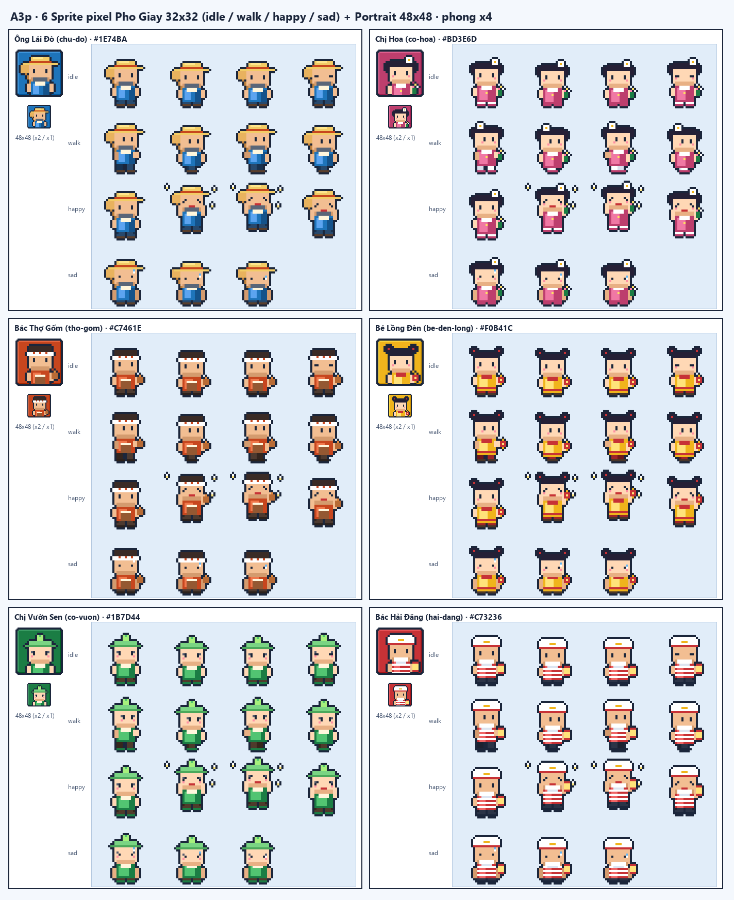

## 2026-11-28 · A6 (Hoàn chỉnh bản đồ pixel 2 vùng đất + bản nhạt giữa bàn — chờ duyệt)
- Người dùng thích cả 2 bản phác Dải đất (muốn giữ nhiều lựa chọn), nên đã xuất đủ cả 2 bản ở khổ gốc `160×240`: `assets/themes/vietnam-map.png` (A · biển xanh RPG, 7,1 KB) và `assets/themes/vietnam-map-vintage.png` (B · giấy cổ vàng kem, 7,4 KB), khai báo trong `vietnam-map.json` (`variants`).
- Đã vẽ `assets/themes/classic-map.png` (`160×240`, 4,8 KB — Phố Giấy nhìn chéo từ trên xuống, dòng sông liền mạch, 2 cầu, 8 khu đúng màu A1, ao sen, hải đăng, thuyền, người nhỏ) + `classic-map.json` + ảnh xem trước `check/classic-map-preview.png`.
- Đã tạo 2 bản nhạt cho giữa bàn: `assets/themes/vietnam-board.png` (7,2 KB, mọi pixel đạt AA ≥ 8,96:1 với `--ink` và ≥ 4,65:1 với `--ink-2`) và `assets/themes/classic-board.png` (4,7 KB, mọi pixel đạt AA ≥ 9,45:1 với `--ink` và ≥ 4,70:1 với `--ink-2`), kèm ảnh kiểm tra `check/boards-preview.png`.
- Việc tiếp theo: làm **A3p** (6 sprite Phố Giấy có hoạt ảnh + xóa avatar vector cũ) → **A4p** → **G2**. Đang vướng: không.

| Phố Giấy (`classic-map.png` ×3) | Kiểm tra chữ trên 2 bản nhạt giữa bàn |
|---|---|
| 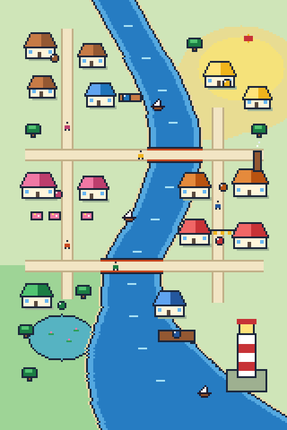 | 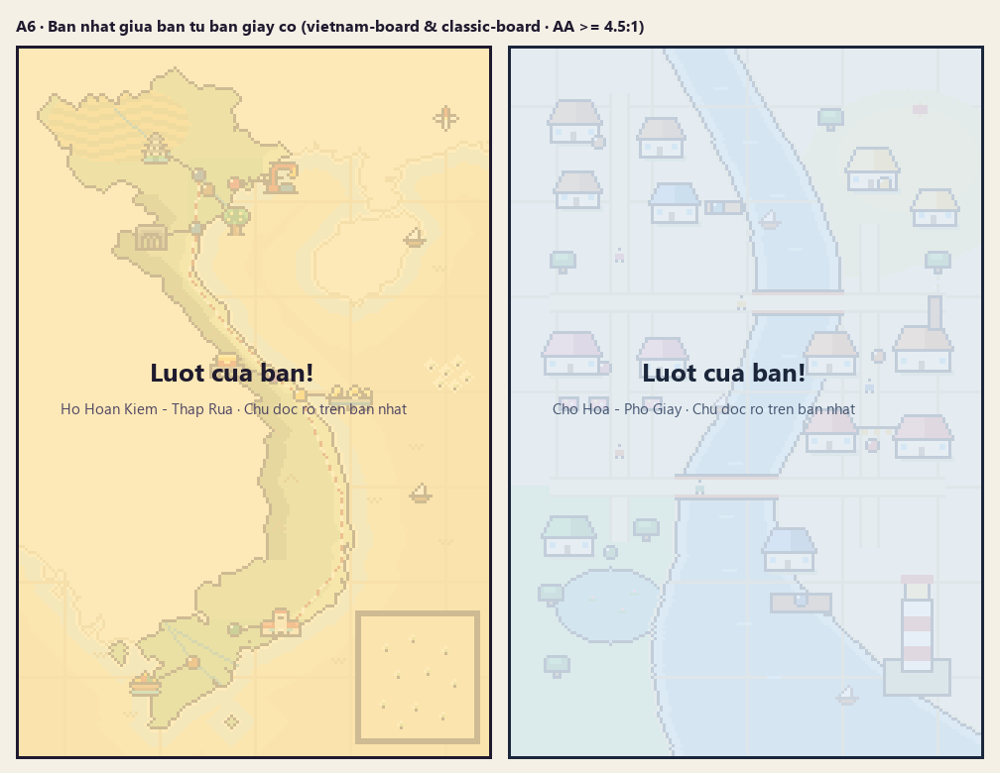 |

## 2026-11-28 · A2p (6 sprite pixel Dải đất có hoạt ảnh — chờ duyệt)
- Đã vẽ 6 sprite sheet pixel chibi 32×32 (128×128, 4 hàng `idle`/`walk`/`happy`/`sad`, mỗi sheet 2,0–2,6 KB < 20 KB) + 6 chân dung nửa người 48×48 + cập nhật `assets/avatars/vietnam/avatars.json` theo đúng schema `docs/UI_REFRESH.md` mục 0.4.
- Đã sửa triệt để mọi góp ý từ bản vector: **Cô Hai** (`non-la`) có quai nón dưới cằm không vắt ngang mặt + quang gánh; **Minh Thư** (`ao-dai`) mặc áo dài hồng sen thật tà dài tới gối xẻ hai bên lộ quần dài trắng và tà bay khi `walk`; 6 màu áo chính khác nhau hoàn toàn ở 32px (đỏ son, vàng mai, hồng sen, xanh ngọc, sọc xanh biển, xanh lá mạ).
- File: `assets/avatars/vietnam/*.png`, `assets/avatars/vietnam/avatars.json`, `assets/avatars/SOURCES.md`, `assets/avatars/check/vietnam-sprites.png`, `assets/avatars/check/vietnam-sprites.gif`.
- Việc tiếp theo: chờ người dùng duyệt **A6 phác** (chọn A hay B để hoàn thiện cả 2 map) và **A2p**; sau đó làm **A3p** (6 sprite Phố Giấy + dọn SVG cũ) → **A4p** → **G2**. Đang vướng: không.

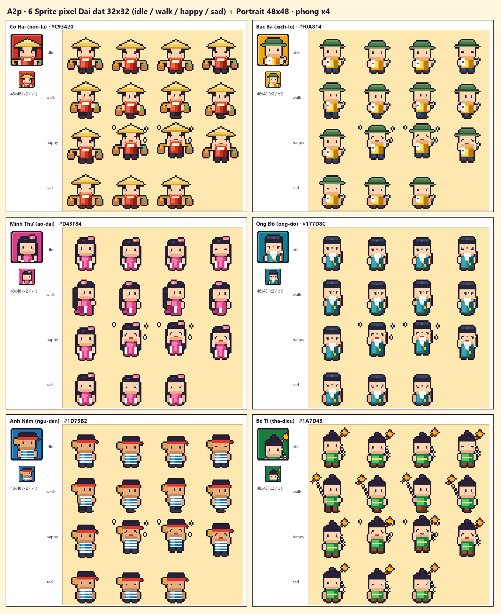

## 2026-11-28 · A6 phác (2 bản phác bản đồ Dải đất kiểu pixel — chờ duyệt)
- Đã dựng 2 bản phác bản đồ Dải đất (gốc `160×240`, phóng ×3 = `480×720`, không chữ) từ đường bờ Natural Earth 50m (public domain): đủ địa hình Bắc–Trung–Nam, ruộng bậc thang Tây Bắc, Trường Sơn, sông Hồng, sông Mê Kông, đường sắt Thống Nhất, 8 chấm màu quận kèm 8 địa danh pixel 11–15px (Tháp Rùa mái đá xám, cần cẩu Hải Phòng, cây nhãn Hưng Yên, cổng Thành Nhà Hồ, Ngọ Môn, Cầu Rồng, Chợ Bến Thành, chợ nổi), Phú Quốc, Côn Đảo, **Quần đảo Hoàng Sa** và khung **Quần đảo Trường Sa**.
- File: `assets/themes/check/vietnam-map-draft-a.png` (A · biển xanh RPG rực rỡ, 11,4 KB), `assets/themes/check/vietnam-map-draft-b.png` (B · bản đồ giấy cổ vàng kem nắng, 12,2 KB), `assets/themes/vietnam-map.json`, `assets/themes/SOURCES.md`.
- Việc tiếp theo: chờ người dùng chọn bản A hay B ở A6; trong lúc chờ chuyển sang làm **A2p** (6 sprite Dải đất có hoạt ảnh). Đang vướng: chờ người dùng duyệt A6 phác.

| A · Biển xanh đậm RPG | B · Bản đồ giấy cổ vàng kem |
|---|---|
| 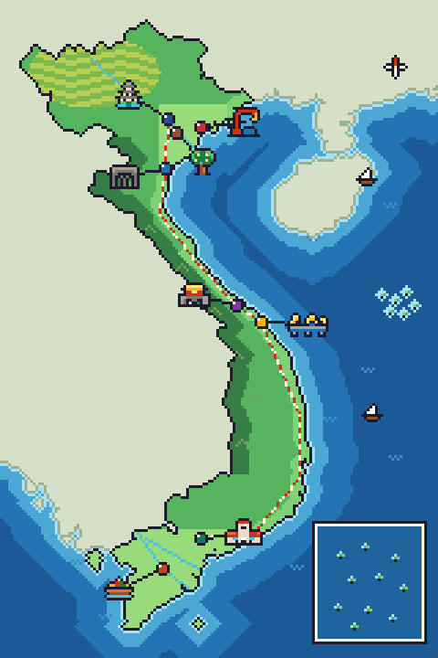 | 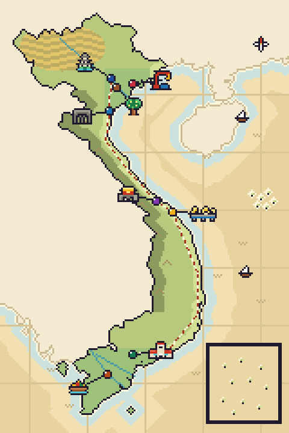 |

## 2026-11-28 · A5 (UI kit pixel — chờ duyệt)
- Đã vẽ trọn bộ UI kit pixel ở độ phân giải gốc (không khử răng cưa, nền trong suốt, mọi file ≤ 275 byte < 20 KB) theo đúng bảng màu A1 (`design/themes/palettes.md`):
  - 16 khung 9 ô (`border-image`): 8 khung Dải đất mặc định (`frame-panel`, `frame-card`, `frame-tile`, `btn`, `btn-press`, `btn-primary`, `btn-primary-press`, `input`) và 8 bản `-classic.png` cho Phố Giấy.
  - 23 icon 16×16 trong `assets/ui/icons/` (đủ ga, điện, nước, thuế, 3 loại thẻ, 4 ô góc, nhà, khách sạn, xu, xúc xắc 1–6, vé, máy bay, cảnh báo).
  - Tài liệu `assets/ui/README.md` (đầy đủ `border-image-slice` & mẫu CSS), `assets/ui/SOURCES.md` và ảnh kiểm tra phóng ×4 `assets/ui/check/ui-kit.png`.
- Việc tiếp theo: làm **A2p** (6 sprite pixel 32×32 có hoạt ảnh `idle`/`walk`/`happy`/`sad` + chân dung 48×48 cho Dải đất). Đang vướng: không.

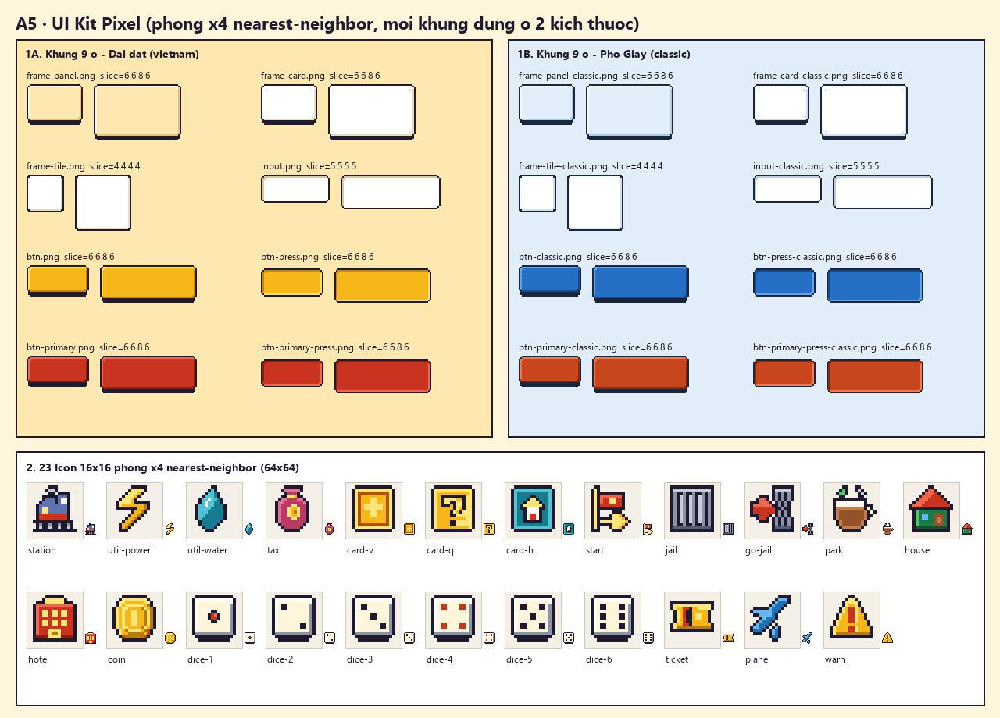

## 2026-11-28 · A4 (Minh họa giữa bàn 2 vùng đất — chờ duyệt)
- Đã vẽ `assets/themes/vietnam-board.svg` (4,9 KB — dải đất chữ S cách điệu, đường nối và điểm đánh dấu 8 thành phố theo bảng màu A1, mây sóng & la bàn) và `assets/themes/classic-board.svg` (3,8 KB — sông giấy, đồi nắng gấp giấy và 8 biểu tượng khu phố), đều xa dưới ngưỡng 80 KB.
- Đã kiểm tra trực quan khi đặt chữ tiêu đề, mô tả và nút giữa bàn đè lên trên: độ mờ được hạ dịu (`0,22–0,45`) để mọi chữ đọc sắc nét, cập nhật `--board-art` trong `design/themes/palettes.md`.
- File: `assets/themes/vietnam-board.svg`, `assets/themes/classic-board.svg`, `design/themes/palettes.md`.
- Việc tiếp theo: chờ **Cổng duyệt 2** (người dùng xem lab theme + avatar), có thể làm **G2** (`assets/stacks/STYLE.md`) trong lúc chờ. Đang vướng: không.

## 2026-11-28 · A3 (6 avatar cư dân Phố Giấy — chờ duyệt)
- Đã vẽ đủ 6 cư dân Phố Giấy (`chu-do`, `co-hoa`, `tho-gom`, `be-den-long`, `co-vuon`, `hai-dang`) cùng hệ nét viền sticker dày với A2: mỗi nhân vật có portrait SVG 256×256 + token 64×64 đọc rõ ở 24px, mọi file 1,0–2,6 KB (< 40 KB).
- Đã tạo `assets/avatars/classic/avatars.json`, cập nhật `assets/avatars/SOURCES.md` và chụp bảng kiểm tra `assets/avatars/check/classic-sheet.png`.
- File: `assets/avatars/classic/*`, `assets/avatars/SOURCES.md`, `assets/avatars/check/classic-sheet.png`.
- Việc tiếp theo: làm **A4** (minh họa giữa bàn `assets/themes/vietnam-board.svg` và `classic-board.svg`, màu nhạt dưới chữ, < 80 KB). Đang vướng: không.

## 2026-11-27 · A2 (6 avatar vùng đất Dải đất — chờ duyệt)
- Đã vẽ đủ 6 nhân vật Dải đất (`non-la`, `xich-lo`, `ao-dai`, `ong-do`, `ngu-dan`, `tha-dieu`) dạng SVG vector nét đậm kiểu sticker (đồng bộ sprite A · Pixel): mỗi nhân vật có portrait 256×256 + token 64×64 đọc rõ ở 24px, mọi file 1,0–3,1 KB (< 40 KB).
- Đã tạo `assets/avatars/vietnam/avatars.json`, `assets/avatars/SOURCES.md` và bảng kiểm tra 6 chân dung + 6 token ở cỡ 24px tại `assets/avatars/check/vietnam-sheet.png`.
- File: `assets/avatars/vietnam/*`, `assets/avatars/SOURCES.md`, `assets/avatars/check/vietnam-sheet.png`.
- Việc tiếp theo: làm **A3** (6 cư dân Phố Giấy) rồi **A4** (minh họa giữa bàn). Đang vướng: không.

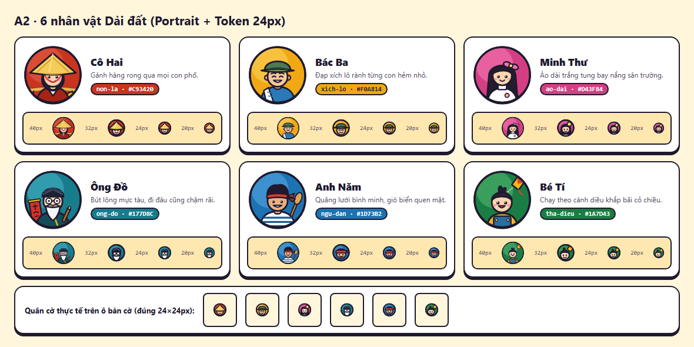

## 2026-11-27 · A1 (Bảng màu + hoa văn 2 vùng đất — Style "Rực rỡ")
- Đã chốt bảng màu rực rỡ đủ toàn bộ biến ở mục 2 `docs/UI_REFRESH.md` cho 2 vùng đất (`vietnam` — Dải đất, `classic` — Phố Giấy), kiểm chứng tự động 44/44 cặp chữ/nền đều đạt WCAG 2.1 AA ≥ 4,83:1.
- Đã vẽ 2 hoa văn lặp SVG nền trong suốt (`assets/themes/vietnam-pattern.svg` sóng nước & mây, `assets/themes/classic-pattern.svg` giấy gấp & chấm lưới) và 2 ảnh swatch (`assets/themes/vietnam-swatch.png`, `assets/themes/classic-swatch.png`).
- File: `design/themes/palettes.md`, `assets/themes/vietnam-pattern.svg`, `assets/themes/classic-pattern.svg`, `assets/themes/vietnam-swatch.png`, `assets/themes/classic-swatch.png`.
- Việc tiếp theo: làm **A2** (6 avatar Dải đất: portrait 256×256 + token đọc rõ ở 24px + `avatars.json` + `SOURCES.md`) và **G2** (`assets/stacks/STYLE.md`). Đang vướng: không.

## 2026-11-27 · G1 (Cổng duyệt 1 → chốt kiểu A · Pixel, sửa mái Tháp Rùa)
- Đã tạo đủ 3 địa danh thử × 2 kiểu (**A · Pixel** và **B · Giấy xếp lớp** = 6 asset), chạy `../Monopoly-codex/tools/art/build_stacks.py --bake16` ra dải lát cắt, sheet 16 góc, 6 check sheet và `manifest.json`; mọi ảnh gốc dưới 5 KB, mọi dải lát cắt dưới 7 KB (dưới ngưỡng 60 KB / 400 KB).
- Theo phản hồi của người dùng ở Cổng duyệt 1 (**chọn kiểu A · Pixel** và góp ý mái Tháp Rùa không phải màu đỏ): đã sửa mái Tháp Rùa sang màu đá xám rêu phong cổ (`#7A776C`/`#5F5D54`, chóp đá `#9E9887`) khớp kiến trúc thật, cắt lớp lại và chụp mới `g1-lab-compare.png`.
- File: `assets/stacks/src/*`, `assets/stacks/out/*`, `assets/stacks/check/*`, `assets/stacks/manifest.json`, `assets/stacks/SOURCES.md`, `design/lab/g1-compare.html`.
- Việc tiếp theo: chờ người dùng xác nhận bản Tháp Rùa đã sửa màu mái rồi bắt đầu **G2 (`assets/stacks/STYLE.md`)** và **G3 đợt 1** (6 địa danh Hưng Yên, Thanh Hóa) theo **kiểu A · Pixel**.
- Đề xuất gửi Codex (không tự sửa vùng của Codex):
  1. Trong `src/render/stack.js:186` (`mountTurntable`), dòng `(canvas.clientHeight + size.height * scale) / 2 - 4` đang đặt `baseY` xuống sát đáy canvas nên khi `scale >= 3.5` đáy mô hình bị cắt ở mép dưới (thấy rõ ở ảnh `g1-lab-mobile.png` và `deedCanvas` trong `stack.html:95`). Đề xuất đổi thành `(canvas.clientHeight - size.height * scale) / 2 + size.baseY * scale` để căn đúng giữa khung.
  2. Trong `tools/art/build_stacks.py:84`, font mặc định của Pillow không hỗ trợ dấu tiếng Việt nên nhãn `"tách lớp"` trên check sheet hiện `t□ch l□p`; có thể dùng `"tach lop"` hoặc nạp font TTF hệ thống.

### Cổng duyệt 1 · Bảng so sánh A (Pixel) vs B (Giấy xếp lớp) trên `src/render/stack.js`

### Ảnh chụp trang lab của Codex (`design/lab/stack.html`) với manifest G1 thật

| Desktop (1280px, Tháp Rùa · B giấy + Xem trên bàn) | Mobile (390px, Cầu Rồng · A pixel) |
|---|---|
| 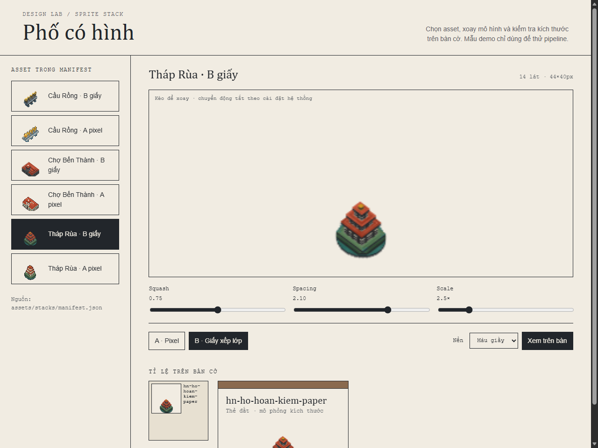 |  |

### 6 Check sheet (4 góc 35°/135°/225°/315° + tách lớp)

| Địa danh | A · Pixel | B · Giấy xếp lớp |
|---|---|---|
| **Hồ Hoàn Kiếm – Tháp Rùa** |  |  |
| **Cầu Rồng (`parts`)** | 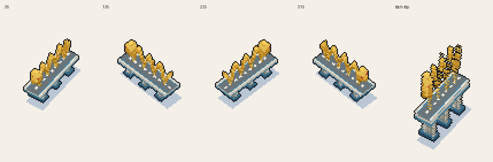 |  |
| **Chợ Bến Thành (`parts`)** | 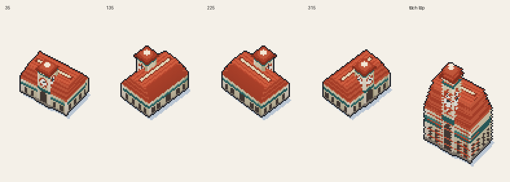 | 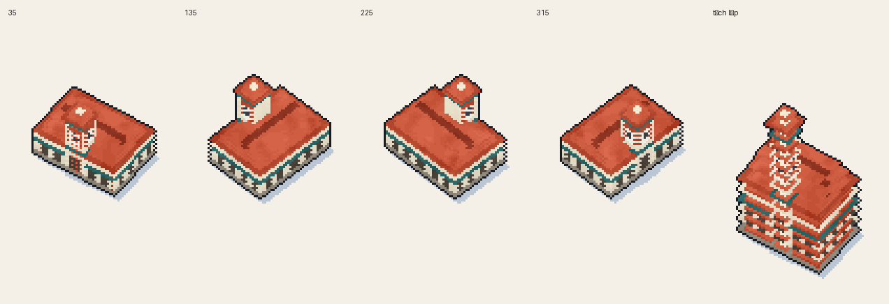 |
