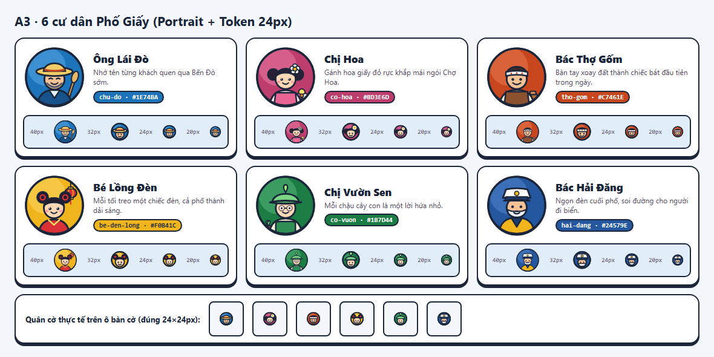
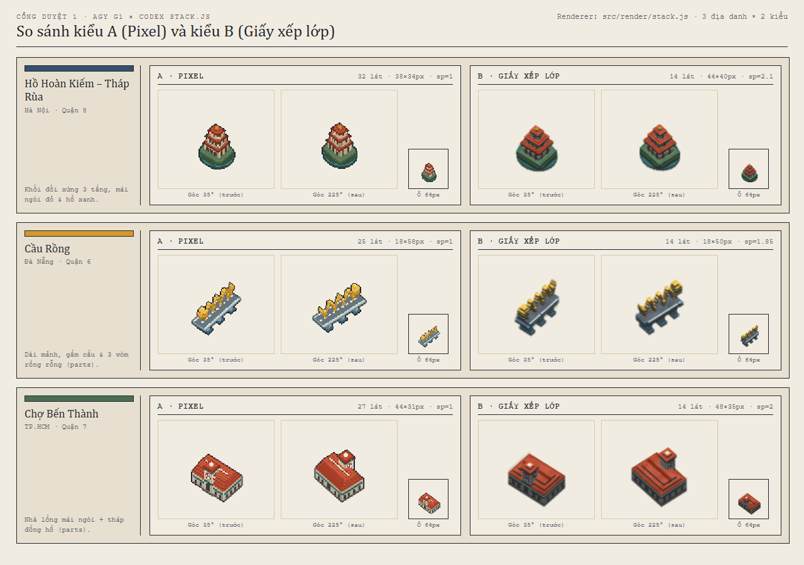
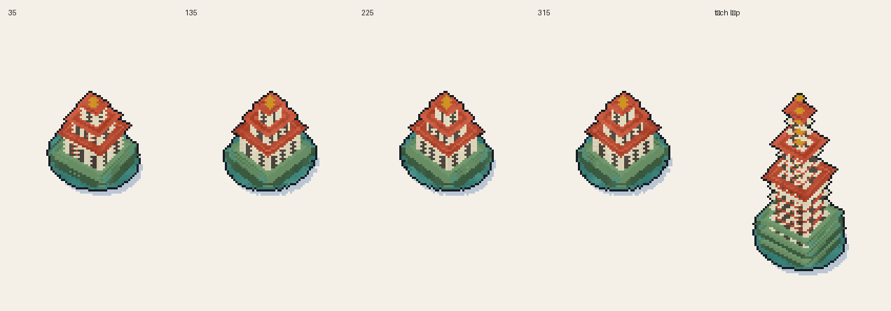
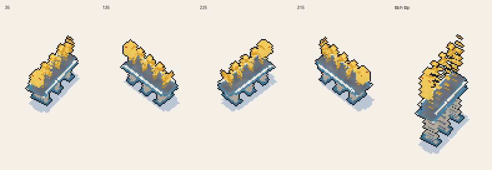

# Nhật ký agent Agy

## 2026-11-27 · G6
- Đã tạo nội dung chữ cho map Việt Nam (40 ô, 13 loại thẻ Vận mệnh, gợi ý Thanh Hóa) và chạy `node --test tests/*.test.mjs` (17/17 xanh).
- File: `content/vietnam.json`.

## 2026-11-28 · A4 (Minh họa giữa bàn 2 vùng đất — chờ duyệt)
- Đã vẽ `assets/themes/vietnam-board.svg` (4,9 KB — dải đất chữ S cách điệu, đường nối và điểm đánh dấu 8 thành phố theo bảng màu A1, mây sóng & la bàn) và `assets/themes/classic-board.svg` (3,8 KB — sông giấy, đồi nắng gấp giấy và 8 biểu tượng khu phố), đều xa dưới ngưỡng 80 KB.
- Đã kiểm tra trực quan khi đặt chữ tiêu đề, mô tả và nút giữa bàn đè lên trên: độ mờ được hạ dịu (`0,22–0,45`) để mọi chữ đọc sắc nét, cập nhật `--board-art` trong `design/themes/palettes.md`.
- File: `assets/themes/vietnam-board.svg`, `assets/themes/classic-board.svg`, `design/themes/palettes.md`.
- Việc tiếp theo: chờ **Cổng duyệt 2** (người dùng xem lab theme + avatar), có thể làm **G2** (`assets/stacks/STYLE.md`) trong lúc chờ. Đang vướng: không.

## 2026-11-28 · A3 (6 avatar cư dân Phố Giấy — chờ duyệt)
- Đã vẽ đủ 6 cư dân Phố Giấy (`chu-do`, `co-hoa`, `tho-gom`, `be-den-long`, `co-vuon`, `hai-dang`) cùng hệ nét viền sticker dày với A2: mỗi nhân vật có portrait SVG 256×256 + token 64×64 đọc rõ ở 24px, mọi file 1,0–2,6 KB (< 40 KB).
- Đã tạo `assets/avatars/classic/avatars.json`, cập nhật `assets/avatars/SOURCES.md` và chụp bảng kiểm tra `assets/avatars/check/classic-sheet.png`.
- File: `assets/avatars/classic/*`, `assets/avatars/SOURCES.md`, `assets/avatars/check/classic-sheet.png`.
- Việc tiếp theo: làm **A4** (minh họa giữa bàn `assets/themes/vietnam-board.svg` và `classic-board.svg`, màu nhạt dưới chữ, < 80 KB). Đang vướng: không.

## 2026-11-27 · A2 (6 avatar vùng đất Dải đất — chờ duyệt)
- Đã vẽ đủ 6 nhân vật Dải đất (`non-la`, `xich-lo`, `ao-dai`, `ong-do`, `ngu-dan`, `tha-dieu`) dạng SVG vector nét đậm kiểu sticker (đồng bộ sprite A · Pixel): mỗi nhân vật có portrait 256×256 + token 64×64 đọc rõ ở 24px, mọi file 1,0–3,1 KB (< 40 KB).
- Đã tạo `assets/avatars/vietnam/avatars.json`, `assets/avatars/SOURCES.md` và bảng kiểm tra 6 chân dung + 6 token ở cỡ 24px tại `assets/avatars/check/vietnam-sheet.png`.
- File: `assets/avatars/vietnam/*`, `assets/avatars/SOURCES.md`, `assets/avatars/check/vietnam-sheet.png`.
- Việc tiếp theo: làm **A3** (6 cư dân Phố Giấy) rồi **A4** (minh họa giữa bàn). Đang vướng: không.

## 2026-11-27 · A1 (Bảng màu + hoa văn 2 vùng đất — Style "Rực rỡ")
- Đã chốt bảng màu rực rỡ đủ toàn bộ biến ở mục 2 `docs/UI_REFRESH.md` cho 2 vùng đất (`vietnam` — Dải đất, `classic` — Phố Giấy), kiểm chứng tự động 44/44 cặp chữ/nền đều đạt WCAG 2.1 AA ≥ 4,83:1.
- Đã vẽ 2 hoa văn lặp SVG nền trong suốt (`assets/themes/vietnam-pattern.svg` sóng nước & mây, `assets/themes/classic-pattern.svg` giấy gấp & chấm lưới) và 2 ảnh swatch (`assets/themes/vietnam-swatch.png`, `assets/themes/classic-swatch.png`).
- File: `design/themes/palettes.md`, `assets/themes/vietnam-pattern.svg`, `assets/themes/classic-pattern.svg`, `assets/themes/vietnam-swatch.png`, `assets/themes/classic-swatch.png`.
- Việc tiếp theo: làm **A2** (6 avatar Dải đất: portrait 256×256 + token đọc rõ ở 24px + `avatars.json` + `SOURCES.md`) và **G2** (`assets/stacks/STYLE.md`). Đang vướng: không.

## 2026-11-27 · G1 (Cổng duyệt 1 → chốt kiểu A · Pixel, sửa mái Tháp Rùa)
- Đã tạo đủ 3 địa danh thử × 2 kiểu (**A · Pixel** và **B · Giấy xếp lớp** = 6 asset), chạy `../Monopoly-codex/tools/art/build_stacks.py --bake16` ra dải lát cắt, sheet 16 góc, 6 check sheet và `manifest.json`; mọi ảnh gốc dưới 5 KB, mọi dải lát cắt dưới 7 KB (dưới ngưỡng 60 KB / 400 KB).
- Theo phản hồi của người dùng ở Cổng duyệt 1 (**chọn kiểu A · Pixel** và góp ý mái Tháp Rùa không phải màu đỏ): đã sửa mái Tháp Rùa sang màu đá xám rêu phong cổ (`#7A776C`/`#5F5D54`, chóp đá `#9E9887`) khớp kiến trúc thật, cắt lớp lại và chụp mới `g1-lab-compare.png`.
- File: `assets/stacks/src/*`, `assets/stacks/out/*`, `assets/stacks/check/*`, `assets/stacks/manifest.json`, `assets/stacks/SOURCES.md`, `design/lab/g1-compare.html`.
- Việc tiếp theo: chờ người dùng xác nhận bản Tháp Rùa đã sửa màu mái rồi bắt đầu **G2 (`assets/stacks/STYLE.md`)** và **G3 đợt 1** (6 địa danh Hưng Yên, Thanh Hóa) theo **kiểu A · Pixel**.
- Đề xuất gửi Codex (không tự sửa vùng của Codex):
  1. Trong `src/render/stack.js:186` (`mountTurntable`), dòng `(canvas.clientHeight + size.height * scale) / 2 - 4` đang đặt `baseY` xuống sát đáy canvas nên khi `scale >= 3.5` đáy mô hình bị cắt ở mép dưới (thấy rõ ở ảnh `g1-lab-mobile.png` và `deedCanvas` trong `stack.html:95`). Đề xuất đổi thành `(canvas.clientHeight - size.height * scale) / 2 + size.baseY * scale` để căn đúng giữa khung.
  2. Trong `tools/art/build_stacks.py:84`, font mặc định của Pillow không hỗ trợ dấu tiếng Việt nên nhãn `"tách lớp"` trên check sheet hiện `t□ch l□p`; có thể dùng `"tach lop"` hoặc nạp font TTF hệ thống.

### Cổng duyệt 1 · Bảng so sánh A (Pixel) vs B (Giấy xếp lớp) trên `src/render/stack.js`

### Ảnh chụp trang lab của Codex (`design/lab/stack.html`) với manifest G1 thật

| Desktop (1280px, Tháp Rùa · B giấy + Xem trên bàn) | Mobile (390px, Cầu Rồng · A pixel) |
|---|---|
|  |  |

### 6 Check sheet (4 góc 35°/135°/225°/315° + tách lớp)

| Địa danh | A · Pixel | B · Giấy xếp lớp |
|---|---|---|
| **Hồ Hoàn Kiếm – Tháp Rùa** |  |  |
| **Cầu Rồng (`parts`)** |  |  |
| **Chợ Bến Thành (`parts`)** |  |  |
